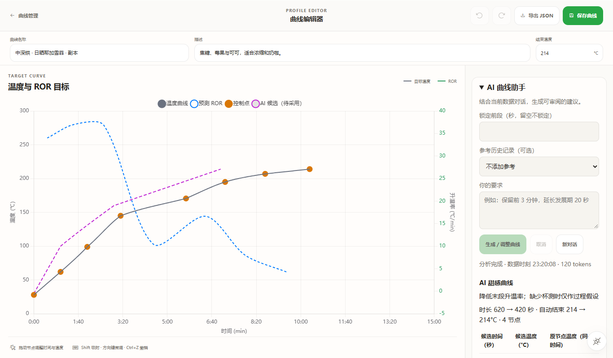
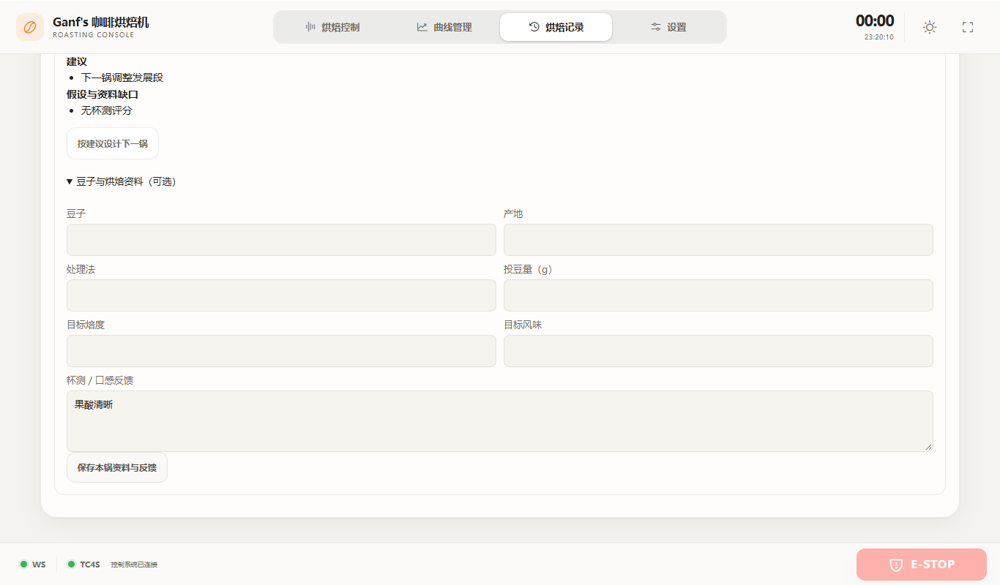
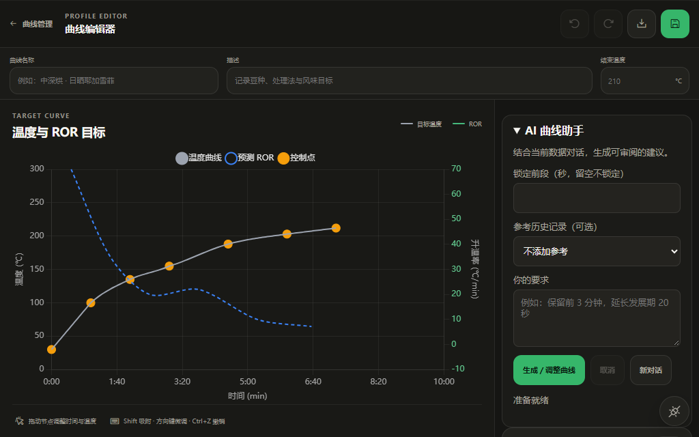
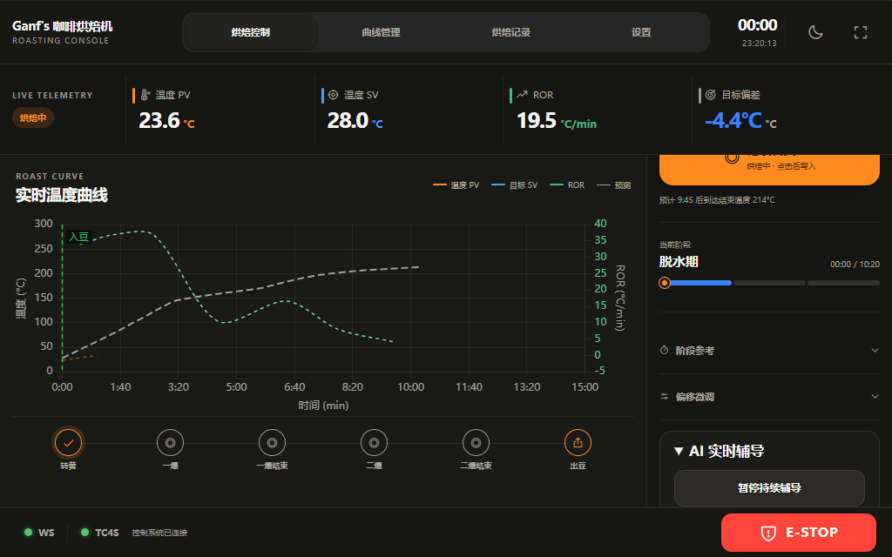

# AI 烘焙助手 v3.22 / 桌面 v0.2.0

日期：2026-10-14。目标测点由用户确认为豆层温度。

## 实现边界

- Windows Tauri 使用共享静态前端，Rust 通过限定命令管理短生命周期 AI 子进程。标准输入传递单次请求与必要凭据，标准输出返回按请求 ID 区分的流事件；取消与窗口销毁终止子进程。AI 不监听本地 HTTP 端口。
- `pi-ai 1.2.0` 锁定依赖，六个供应商工厂按需打包，支持自定义 Chat Completions 兼容接口。Node v24.21.0 的官方 Windows x64 二进制按锁定 SHA256 核验；打包 ESM 文件与动态分块均为 `.mjs`。
- 密钥使用 Windows Generic Credential API，配置/会话 JSON 存在应用数据目录；密钥不进入会话、静态资源、命令行参数或 Git。云端失败不自动切换服务商。
- 工具仅允许读取本次快照的指标/指定采样窗口，以及提交评价/候选。最大六轮工具调用；完整参数校验后才展示结果。原始采样在本机计算指标，模型上下文按五秒桶保留 PV/ROR 极值，必要时读取指定窗口。
- AI 副本保存由用户触发，后端重新读取有效安全上限、校验、生成新 UUID。旧的手工曲线接口与控制命令保持兼容，当前控制曲线不会被 AI 替换。

## 数据与 API

| 接口 | 行为 |
|---|---|
| `GET /api/v1/analysis/context` | 复制状态、当前执行曲线、完整采样和有效安全上限；仅复制期间短暂持有状态锁，锁外序列化，无模型/文件/网络调用 |
| `POST /api/v1/analysis/profiles/validate` | 输入 `profile`、可选 `source`/`locked_until`；返回 `valid/errors`、解析得到的曲线极值与安全上限，无副作用 |
| `POST /api/v1/analysis/profiles` | 待机时校验并保存新 UUID 副本；不应用、不启动；无效候选 422、非待机 409 |
| `PATCH /api/v1/records/{id}/context` | 更新本锅可选 `roast_context` 与 `cup_feedback`；未知记录 404，无效资料 422 |

曲线 JSON 和记录模型增加可选资料；SQLite 追加 `roast_context_json/cup_feedback_json`，支持重复迁移与旧记录空字段。保存一锅时继承当时曲线的豆子/目标资料，烘后可按实际情况修改本锅重量与杯测。原始 telemetry 与 profile_snapshot 保持原样。

候选必须从零秒开始、2–64 个有限节点、时间递增，节点及结束阈值合法。内部样条段求导并检查区间内全部极值；边界段线性，与实际后端一致。锁定区段在所有两曲线节点的并集区间各比较四个位置，覆盖完整三次曲线，而非仅比较同名节点。前端既有边界插值亦修正为与后端一致。

## 已验证

最终主机检查：Node 15 项、Python 9 项、Rust 2 项全部通过；界面集成脚本与前端契约检查通过。正式 NSIS 安装包版本为 0.2.0。

- Node 测试：样条过冲、有限值、结束阈值、插值锁定、浏览器/后端算法对齐、缺事件与缺快照、阶段指标、极值保留、模拟模型工具循环、未知控制工具拒绝、无效候选修复、实时候选拒绝、供应商目录、自定义无密钥流式请求、实际捆绑 Node/ESM 程序执行。
- Python 测试：旧 SQLite 迁移和资料往返、候选边界、ASGI 路由、安全上限、保存不覆盖原曲线、烘焙中拒绝保存、数据校验，以及真实快照方法的复制隔离。ASGI 未启动真实硬件 lifespan。
- Rust 测试：设备历史键隔离；Windows 凭据写/读/删除往返使用本次创建的占位凭据，不访问用户已有密钥。
- 界面集成：安全模拟器 + 模拟 IPC 验证设置、历史复盘、资料保存、加载已有曲线、候选预览、采用、撤销/重做、保存副本、草稿版本保护、取消、持续辅导开关、进入冷却时取消，以及 1366×800/1024×640 和深浅主题。
- 共享前端语法、DOM/资源/图标/主题/急停层级与 Pointer Events 契约检查。

## 验证限制

原生 Tauri 窗口已启动并确认存在，但 Computer Use 助手初始化后持续报 `failed to launch codex app-server: 系统找不到指定的文件 (os error 2)`；重试与内核重置未恢复，因此没有完成原生窗口的自动截图/交互验收。

以下截图来自安全模拟器与模拟原生 IPC，输出是测试夹具，不能作为真实模型评价、真实设备表现或原生窗口验收的证据。未配置生产 API Key，所以没有调用真实云端模型；自定义 SDK 的流式链路仅请求本机测试服务。树莓派部署、真实串口、加热、急停和实豆效果均待目标设备授权后验证。

