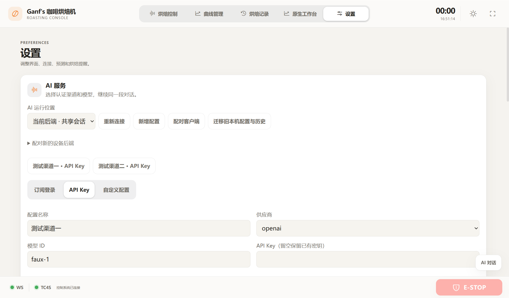
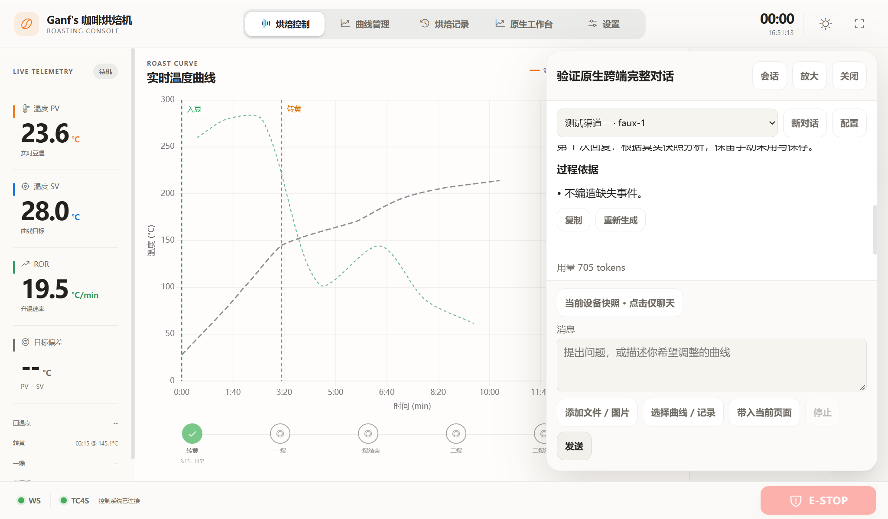
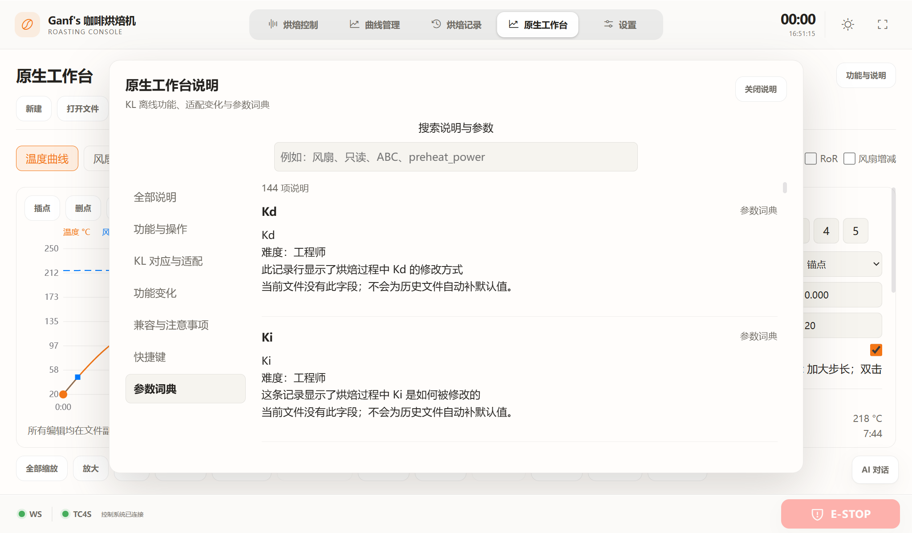
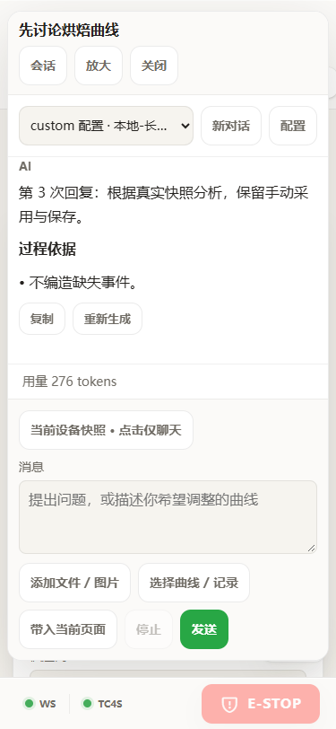

# 原生工作台与 AI 工作区验证

验证日期：2026-10-22。桌面版本 **0.4.0**，共享网页资源 **3.24**。保留本轮之前的未提交工作台成果，未提交或推送 Git，未连接真实烘焙设备。

## 交付内容

- 原生工作台增加离线说明中心，覆盖功能与操作、与 KL 的变化、更新和兼容注意事项，以及 144 项参数检索和操作直达。功能状态依据当前离线实现标注。
- 设置页 AI 配置独占整行，内部统一表单网格；普通卡片按两列拉伸，连接与报警列表整行展示。保留 Calm Canvas、主题、减少动效与急停空间。
- 网页和桌面共用全局聊天：流式多轮、停止、编辑重发、重新生成、会话搜索/重命名/删除、历史恢复、手动切换渠道及模型。附件支持原生文件和图片；模型提示词排除原生文件的未知字段和原始字节。
- 配置区提供订阅登录、API Key、自定义配置。pi-ai 固定 1.2.0，显式打包 OAuth；订阅供应商包括 ChatGPT、Claude、GitHub Copilot、Kimi Code、xAI。
- 长驻 Node JSONL 服务由 Rust 或 Python 管理；默认后端共享配置/对话，桌面可主动选择本机模式。共享服务首次配对，可撤销客户端；旧本机数据迁移需明确操作。
- 原生 AI 工具只读取用户选入的结构化数据和采样。候选先预览、校验再确认采用，一次采用对应一次撤销；日志生成独立 `.kpro`。保存、入库与设备应用仍沿用各自的用户操作。

## 验证结果

| 层次 | 命令或入口 | 结果与证据 |
| --- | --- | --- |
| AI 核心与打包协议 | `cd desktop; npm run test:ai` | 37 项通过，含五家合成授权流程、凭据隔离、刷新串行、取消、持久化、幂等、图片能力、工具边界、本地无密钥流式服务和隔离打包执行 |
| Python/API/原生格式 | `cd roaster; .venv/Scripts/python.exe -m pytest -q` | 51 项通过；1 条第三方 AnyIO 弃用警告。覆盖配对/Origin、宿主默认目录、实际打包服务启动、事件游标恢复、关闭顺序、原生语料与候选 |
| Rust 宿主 | `cd desktop/src-tauri; cargo test` | 4 项通过，覆盖代理 origin、AI 方法白名单、历史与凭据适配 |
| 前端静态契约 | `cd desktop; npm run check:frontend` | 11 个 JS、5 个 CSS、2 个 HTML 契约、45 个现有图标通过 |
| 网页交互 | `cd desktop; npm run test:ai:ui` | [12 项通过，无控制台错误](ai-workspace-v3.24/ui-report.json)；共享核心、确定性模型及安全模拟器 |
| 原生引擎界面 | `cd desktop; npm run test:workbench:native-ui` | 4 项通过，独立数值引擎与原生候选交互 |
| 工作台完整界面 | `cd desktop; npm run test:workbench:ui` | [22 项通过](ai-workspace-v3.24/workbench/ui-report.json)，`sourceEngine=false`，使用打包引擎；含精确撤销、比较/合并、保存取消、导出、真实日志及急停可达 |
| 隔离打包引擎 | `desktop/tools/verify-workbench-package.py` | [11 项通过](ai-workspace-v3.24/workbench-package-report.json)，临时目录运行，不依赖开发源码路径 |
| 实际 Tauri release 窗口 | `cd desktop; npm run test:ai:native-ui` | [2 组通过](ai-workspace-v3.24/native-ui-report.json)；真实 WebView、Rust 配对/代理/事件、打包数值引擎和 144 项帮助；模型和设备均为安全夹具 |
| Windows 构建 | `cd desktop; npm run build` | release EXE 与 NSIS 安装包生成成功；最终 release 窗口已实际运行 |
| ARM64 包静态验证 | `cd desktop; npm run package:ai:arm64` | [源码匹配与架构报告](ai-workspace-v3.24/arm64-package-report.json)：关键前后端文件与工作树一致，Node 为 ELF64/AArch64，执行权限 0755，无用户数据目录 |

原生格式回归沿用 418 个语料：403 个可写文档精确往返，15 个预期诊断，32 个只读场景。保留未知字段、行序、换行、offsets 与事件；未修改字段不重写。

网页布局验证覆盖 1366×800、1024×640、375px 宽、812×375 横屏，深浅主题以及 100%/115%/130% 缩放；检查输入/发送控件、抽屉边界与急停可达。长配置值和动态列表使用可收缩网格与内容驱动高度。实际 Tauri 截图由 Windows 150% DPI 的 WebView 输出，逻辑视口为 1366×800。

本轮同时修正三个部署边界：Python 默认宿主与配对 CLI 使用同一个后端数据目录；Windows 制作的 Linux 归档明确设置 Node 可执行位；关闭应用时先断开设备，再清理 AI，AI 清理异常不跳过设备断开。对应回归均通过。

## 安装与回退

- [Windows x64 安装包](../../dist/RoasterDesktop_0.4.0_x64-setup.exe)
- [ARM64 后端部署包](../../dist/RoasterAIHost_0.4.0_linux_arm64.tar.gz)
- [最终产物 SHA256 与大小](ai-workspace-v3.24/delivery-report.json)
- [共享 AI 配对、部署和迁移说明](../guides/ai-host-deployment.md)
- [原生工作台说明](../guides/native-workbench.md)

升级前保留旧安装包、设备 `config.yaml` 和完整数据目录。ARM64 包解压到新目录，沿用原设备配置，按文档建立虚拟环境。不要用示例配置覆盖设备串口设置。AI 凭据恢复需要同时保留加密数据与对应主密钥；旧本机原文件在主动迁移后仍保留。回退使用原程序和原数据备份，避免让旧版直接写新版会话文件。

## 实际证据的边界

五家授权采用可控交互夹具，验证登录提示、取消、拒绝/过期处理、刷新和退出的程序契约；**未使用真实订阅账号完成供应商授权或付费推理**。账号可用模型与授权额度必须由真实账号在登录后确认。

ARM64 部署包已校验官方 Node 归档、内部文件一致性、架构与权限；**未在树莓派执行、未安装到真实设备**。Windows 安装包构建成功，release WebView 与打包模块已运行；未执行 NSIS 系统安装/卸载流程。

没有真实串口、GPIO、加热器或设备控制证据。安全模拟器和原生窗口结果不能替代树莓派及实机验收。保留计划边界：未新增 KL Link、USB/Wi-Fi、云连接或通用 Word/PDF 解析。

## 界面截图

