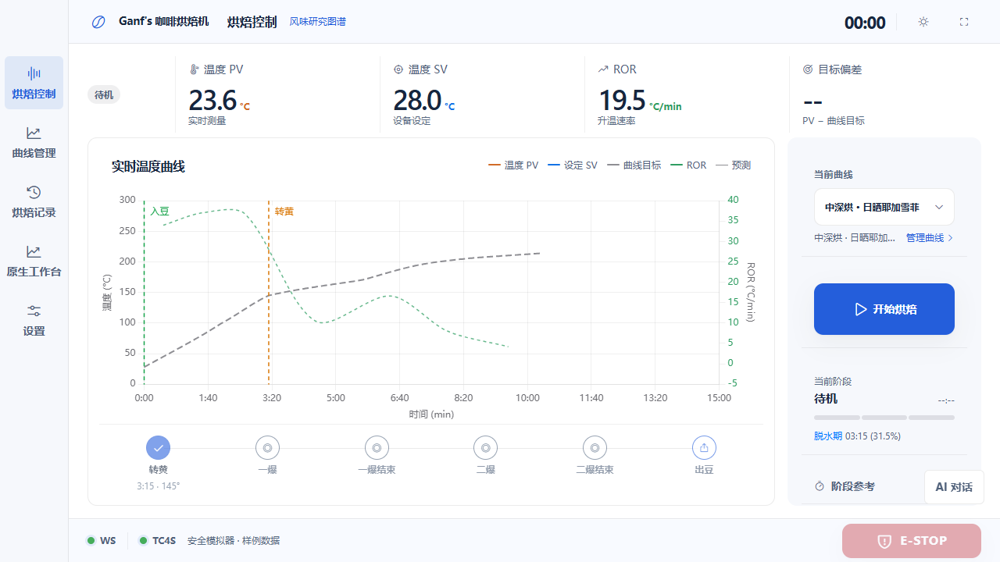
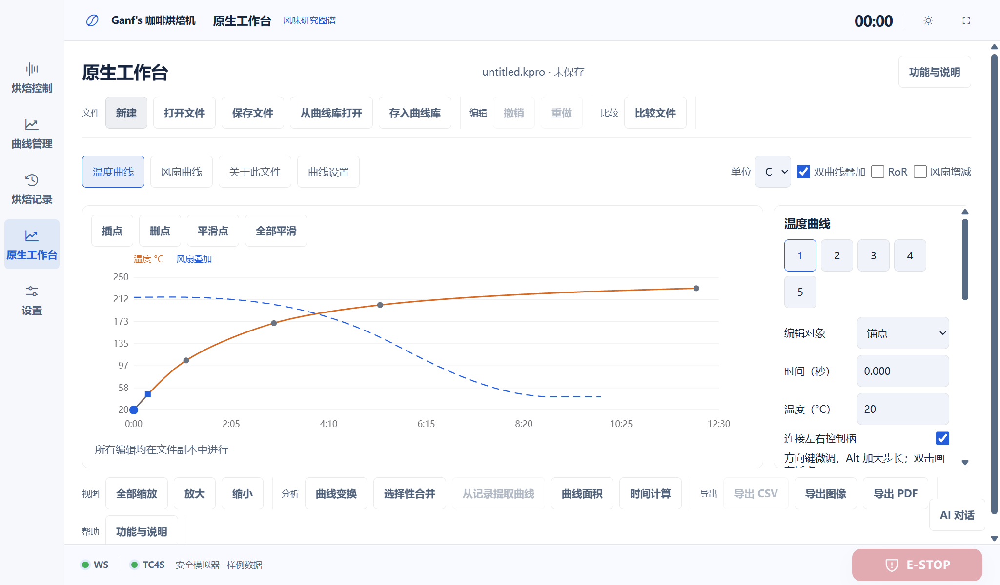

# 2026-10-23 免安装调试修复

## 原因

安装目录已确认包含 Node、AI bundle 与离线 workbench 引擎；直接运行安装目录的引擎并发送 new 请求成功返回 profile。问题在服务边界：桌面包默认请求 localhost:8000，却不会启动设备 HTTP 后端；原有模拟器只提供 API/WS，不托管网页。因此没有后端时，曲线库、记录和共享 AI 获取失败，浏览器也无法从该地址打开界面。此前原生验收先启动了测试服务，没有覆盖这个首次使用路径。

## 修复

- 一键网页入口启动 loopback 开发服务器，统一托管实时源码、API/WS、安全模拟器、离线工作台与真实 AI 核心。
- 新增网页启动、网页停止、原生开发窗口三个根目录入口。原生 devUrl 指向同一服务，复用已经运行的网页调试服务，避免固定端口和 AI 数据锁冲突。
- 桌面后端不可达时显示原因、连接设置、离线工作台和重试动作；file:// 提示使用 HTTP 调试入口。
- 调试 AI 数据与正式数据分开，主密钥由 Windows DPAPI 保护；本机授权、Host/Origin 和静态路径边界均检查。
- 调试页面明确标识样例数据，前端刷新直接读取源码，不通过安装包验证。

## 新鲜验证

| 检查 | 结果 | 证据 |
| --- | --- | --- |
| 前端语法与契约 | 12 JS / 6 CSS / 2 HTML / 45 图标通过 | npm run check:frontend |
| 独立调试服务 | 9项通过，0 pageerror | [report.json](debug-launch-2026-10-23/report.json)；npm run test:dev |
| AI 界面回归 | 12项通过，0 pageerror | 本轮执行 npm run test:ai:ui，共享核心与确定性模型夹具 |
| 实际免安装原生窗口 | 3项通过，0 pageerror | [native-report.json](debug-launch-2026-10-23/native-report.json)；npm run test:dev:native |
| 安装目录离线引擎 | ok=true，kind=profile | 实际已安装的 workbench/RoasterWorkbenchEngine.exe，硬件无关请求 |
| 源码/文档格式 | 通过 | git diff --check |

9项覆盖服务独立启动、同源/鉴权/静态路径隔离、当前网页与3条曲线/WS、无后端说明及离线入口、真实本机 AI 配置、记录、编辑器、原生引擎，以及 AI 历史在服务重启后的恢复。3项原生检查使用 target/debug 中的真实 EXE/WebView/Rust，验证加载当前 HTTP 源码、自动调试配对/RPC 供应商列表和实际离线引擎新建。

浏览器与原生开发窗口均已启动；网页地址为 http://127.0.0.1:18180。没有安装新 NSIS 包，没有覆盖现有安装目录、正式设备配置或账号数据。第一次原生开发构建完成后，后续前端修改可直接刷新。

未连接真实设备、串口或加热器；未调用付费模型或使用真实订阅账号完成授权。

## 截图

