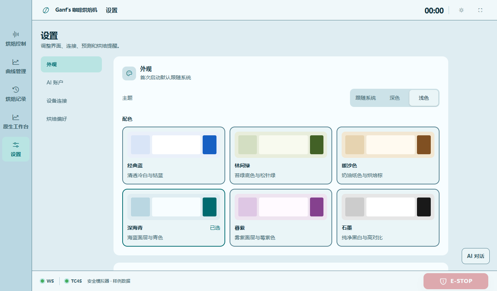
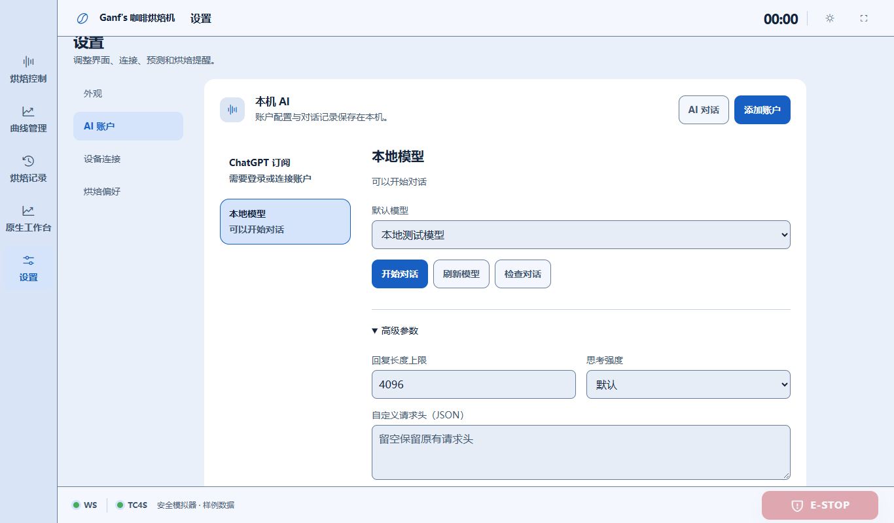
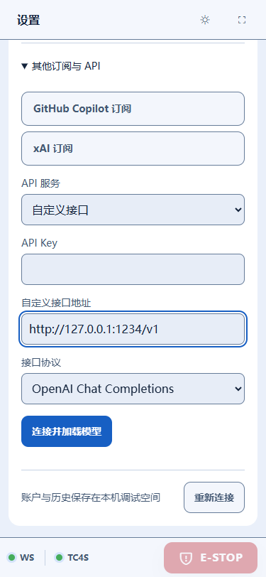

# v3.27 / 桌面 0.6.1 验收

日期：2026-10-23。交付修复浏览器授权、本机 AI 配置、设置层级与六套完整主题。源码与上一轮未提交的调试/界面工作保留，并统一同步到 GitHub。

## 修复结果

授权事件原先只渲染链接，桌面 WebView 没有调用系统默认浏览器。现在通过专用 Rust 命令交给 Windows ShellExecute，拒绝脚本、文件及带账户信息的 URL。授权开始前登记请求 ID，保留打开按钮、复制地址、设备码、取消及失败状态；复制或重试不需要重新创建账户。

桌面固定走本机 AI 服务，旧共享选择不再覆盖它，改变烘焙机连接地址也不改变账户和历史。移除运行位置、共享、配对客户端和远端迁移控件；本地模型入口直接保存无密钥连接并加载其模型目录。Python 后端只对同源、环回 Host 且对端也为环回地址的浏览器开放本机访问，其他访问保持认证。

AI 设置使用账户列表、详情、状态三个明确区域，列表与详情间隔 32px，字段与操作保持 16px 间隔。高级参数与其他 API 使用独立展开区；窄屏单列排列。AI 页标题区提供对话入口，悬浮按钮不遮挡表单底部。

六套配色是经典蓝、林间绿、暖沙色、深海青、暮紫、石墨，均有单独设计的深浅面层、背景、侧栏、文字、输入和选中态；主题预览取自同一套令牌。已选项还有文字提示。普通文字实际最小对比度 4.54:1，动作与焦点最小 4.47:1，输入边界至少 3:1。告警和曲线系列保留语义。

仓库的 `.claude/skills/coffee-roaster-workflow` 和 `.agents/skills/coffee-roaster-workflow` 已移除，两份删除前内容备份在被 Git 忽略的 `desktop/runtime/removed-skills/`。GitHub 同步约定写入根目录 AGENTS.md。

## 验证

| 范围 | 结果 | 证据 |
| --- | --- | --- |
| AI 核心、凭据与协议 | 45 项通过 | `node --test --test-concurrency=1 ai/*.test.mjs`；串行执行避免并发启动超时 |
| Rust | 5 项通过 | Windows 测试凭据往返、URL 边界、RPC 白名单等 |
| Python AI API | 20 项通过 | 本机免配对、远端/异源/重绑定拒绝及现有 AI API/生命周期 |
| 新 AI 与完整主题 | 9 项通过，0 页面错误 | [ui-report.json](local-ai-v3.27/ui-report.json)：真实本机目录、授权弹窗及恢复、展开间距、12 种主题外观对比度、180 次整站尺寸检查 |
| 聊天回归 | 12 项通过，0 页面错误 | [chat/ui-report.json](local-ai-v3.27/chat/ui-report.json)：历史、切换账户、停止恢复、附件、候选比较/明确采用/撤销、急停与缩放 |
| 正式原生程序 | 5 项通过，0 页面错误 | [native/native-ui-report.json](local-ai-v3.27/native/native-ui-report.json)：真实系统浏览器访问、实际 IPC/SDK 两轮本地流式回复、旧共享选择忽略、包内源码一致、离线数值引擎及帮助 |
| 前端契约与布局扫描 | 通过 | 13 JS、6 CSS、2 HTML、45 图标；Impeccable 布局扫描无发现 |
| 安装包 | NSIS 构建成功 | [交付清单](local-ai-v3.27/delivery-report.json)；校验值与字节数见清单 |

真实默认浏览器验证链路为 release WebView → Rust → Windows 默认浏览器 → 本机验证页面收到 HTTP 请求。授权界面回归使用确定性 OAuth 夹具，未替用户完成真实供应商授权；两轮推理来自本机协议夹具。没有调用付费模型、真实串口、GPIO 或加热器，也没有运行安装器覆盖现有安装。

## 交付与预览

Windows 安装包：[RoasterDesktop_0.6.1_x64-setup.exe](../../dist/RoasterDesktop_0.6.1_x64-setup.exe)。源码不会自动更新已经安装的旧程序，需自行安装此版本；免安装预览可双击根目录「调试网页.cmd」或「调试桌面.cmd」。

