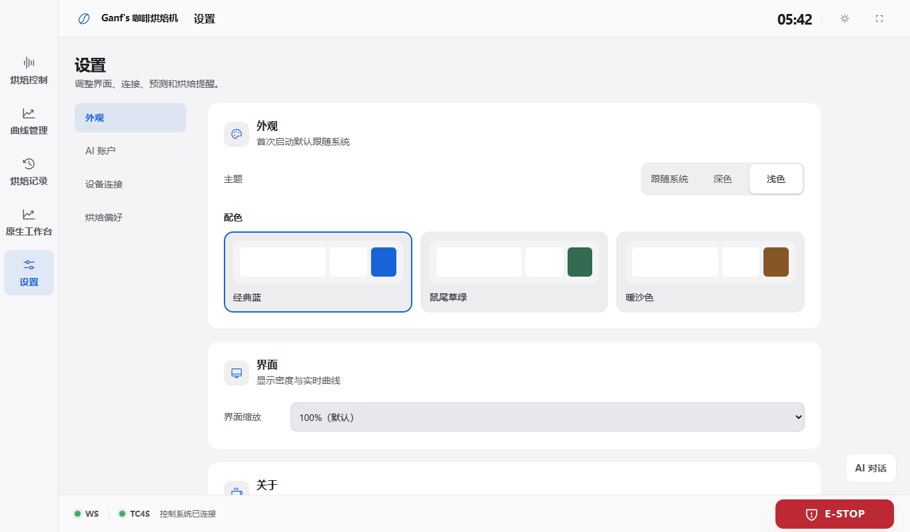
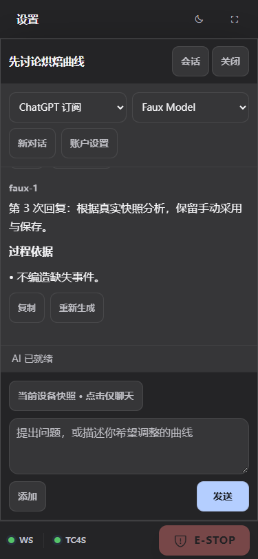
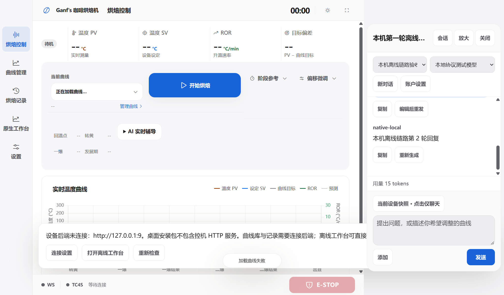

# 桌面 0.6.0 / Web 3.26 验收记录

日期：2026-10-23。实现范围为全局主题、设置与 AI 工作区。用户已明确将真实订阅授权留到实际使用，本次交付不以账号登录为前置条件。

## 交付

- Windows x64 安装包：[RoasterDesktop_0.6.0_x64-setup.exe](../../dist/RoasterDesktop_0.6.0_x64-setup.exe)，42,285,425 字节。[SHA256](../../dist/RoasterDesktop_0.6.0_x64-setup.exe.sha256)。
- SHA256：`281b1bda7a14b9bb5e069cafd5d4ffee71125d34afd6512a204de9b88c6e3c28`。
- 当前调试预览：[AI 账户](http://127.0.0.1:18180/?settings=ai)。重开方式：项目根目录「调试网页.cmd」；原生开发窗口使用「调试桌面.cmd」。
- [机器可读交付记录](workspace-v3.26/delivery-report.json)、[设计规范](../../DESIGN.md)、[主题令牌侧车](../../.impeccable/design.json)、[调试与打包说明](../guides/debugging-and-packaging.md)。

安装包已构建并复制到 `dist`，没有运行安装器或覆盖用户现有安装目录。原生验收运行的是本次 release EXE、真实 WebView/Rust、随包 Node 与数值引擎。旧版 ARM64 归档属于历史交付，不代表本次设备端验收。

## 已实现

经典蓝、鼠尾草绿、暖沙色各支持浅色、深色和系统外观。旧明暗选择独立保留，未选配色时默认经典蓝。圆角分组、正常字号、按钮、图表、编辑器、原生工作台、反馈与 AI 侧栏使用共享令牌。

设置分为外观、AI 账户、设备连接、烘焙偏好。常用三家账户优先显示，名称自动生成，模型通过目录选择并自动保存；更多服务、API Key、自定义接口及设备共享位于次级入口。账户连接、授权中、目录加载、需要重登、空目录及失败有对应提示和恢复动作。删除账户保留历史，不自动选择另一计费渠道。

ChatGPT 使用账户目录，并将新模型注册到推理集合；订阅请求修正 developer 角色、namespace 工具及流式字段。Kimi Code 使用官方账户模型目录和能力信息。Claude 通过官方 Claude Code 登录、初始化列模型和执行，最低版本 2.1.248；关闭内建操作工具、MCP 和浏览器，用户文本使用结构化消息，凭据由官方客户端管理。当前本机 2.1.241 能正确触发升级提示，没有替用户升级或登录。

桌面首次默认本机 AI，设备后端离线时可以聊天；网页使用所在服务，旧的明确宿主选择保留。统一浏览器与原生传输、断线事件恢复及停止。聊天保留停靠和放大视图，历史抽屉、单一附件入口、独立账户/模型选择和相同位置的发送/停止按钮。AI 只分析和提出候选，采用、保存与应用仍由用户执行。

## 验证结果

| 范围 | 结果 | 证据与限制 |
| --- | --- | --- |
| AI 核心和协议 | 45 项通过 | `desktop` 中 `npm run test:ai`；真实 SDK 请求契约、账户目录与注册、重登/过期、空目录、下架、断网、删除保留历史、停止/重试/重启及候选校验 |
| Claude 子进程 | 包含于上述 45 项 | 受控可执行子进程验证 initialize、模型列表、流式输出、取消、版本与参数、环境隔离及字面用户文本；未执行真实订阅推理 |
| Python AI API | 18 项通过 | `roaster/.venv/Scripts/python.exe -m unittest discover -s tests -p 'test_ai*.py'`，在 `roaster` 执行；配对、RPC/事件与白名单 |
| Rust | 4 项通过 | `cargo test --manifest-path src-tauri/Cargo.toml`，在 `desktop` 执行 |
| 前端契约 | 通过 | 13 JS、6 CSS、2 HTML、45 图标；`npm run check:frontend` |
| 主题和全站布局 | 100 项通过，0 pageerror | [layout-report.json](workspace-v3.26/layout-report.json)；三配色×深浅×1366/1024/375×五工作区，系统实时变化、重载与旧明暗选择、曲线预览/明确应用、冷却与急停、编辑器 |
| AI 浏览器操作 | 12 项通过，0 pageerror | [ui-report.json](workspace-v3.26/ui-report.json)；首次添加至自动保存的模拟授权流程、多轮、换账户、历史、编辑重发、停止重连、原生附件与明确采用 |
| 正式原生程序 | 3 项通过，0 pageerror | [native-ui-report.json](workspace-v3.26/native-ui-report.json)；设备后端不可达时，本机目录及两轮真实 IPC/SDK 流式传输；共享宿主配对；打包数值引擎与144项帮助及急停。响应来自本机协议夹具 |
| 独立调试服务 | 9 项通过，0 pageerror | [report.json](debug-launch-2026-10-23/report.json)；本机真实核心、当前源码、样例/WS、离线工作台、访问边界及重启后的历史恢复 |
| 当前 0.6.0 原生开发窗口 | 3 项通过，0 pageerror | [native-report.json](workspace-v3.26/native-dev/native-report.json)；实际 debug EXE/WebView/Rust 加载实时源码、调试 AI 和数值引擎 |
| 独立视觉复核 | 三项必修已解决 | [visual-review.md](workspace-v3.26/visual-review.md)；横屏消息区、横屏上下文可见、占位文字对比度；修复评分为 ship |
| 设计文档 | 一致性验证通过 | 137 个颜色与最终 CSS 对应、组件引用、色阶及叙述映射；未声称运行官方设计导入检查器 |
| 构建 | release NSIS 与 dev 构建成功 | release 0.6.0 内嵌当前 CSS/JS；HTML 比较经过解析的应用 body，排除 Tauri 的 head 注入和序列化差异 |

浏览器视口覆盖桌面、1024×640 触屏尺寸、375px 手机和812×375横屏；100/115/130%缩放、输入区、已选上下文和急停均有截图/操作检查。这些证据来自桌面浏览器或 WebView，未冒充真实手机、触屏硬件或加热设备验证。

## 真实账户状态

| 渠道 | 本次状态 |
| --- | --- |
| ChatGPT | 已实现官方授权与账户目录链路；真实账号授权、自动模型目录及两轮云端对话未验收 |
| Kimi Code | 已实现官方授权与账户目录链路；真实账号授权、自动模型目录及两轮云端对话未验收 |
| Claude Code | 已实现官方 CLI 路由和版本引导；真实新版客户端授权、初始化目录及两轮云端对话未验收 |

因此本次不把任一家渠道标记为“真实订阅已验证可用”。用户首次实际使用时自行授权，无需在交付阶段提供密码、令牌或密钥。模拟测试与真实运行时证据分别列明；未调用付费模型、串口、GPIO、加热器或真实控机后端，未改动原生文件保真与设备控制权限。

## 截图

